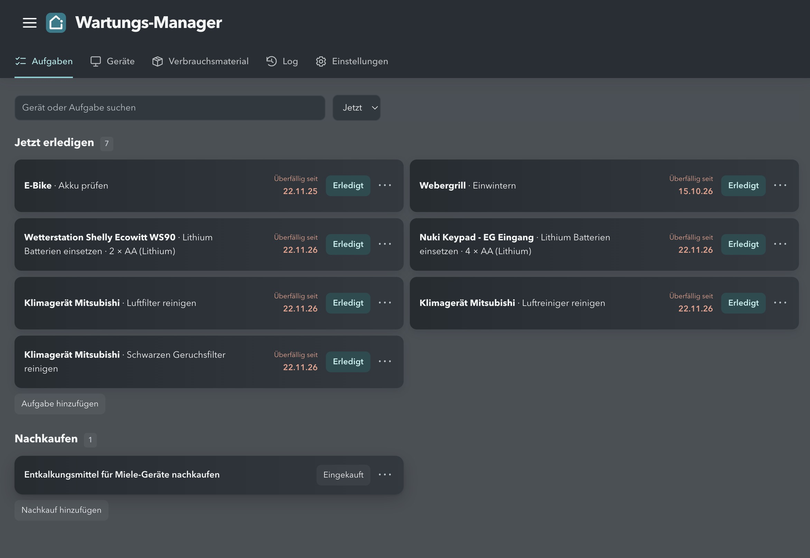
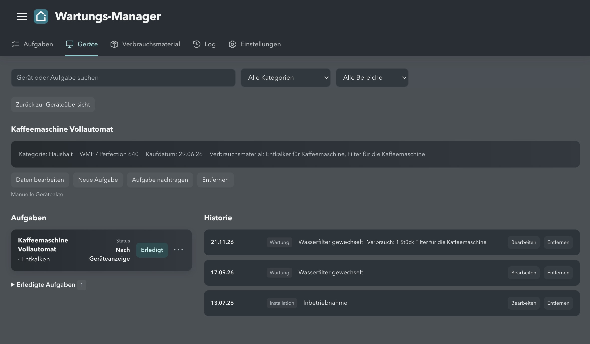
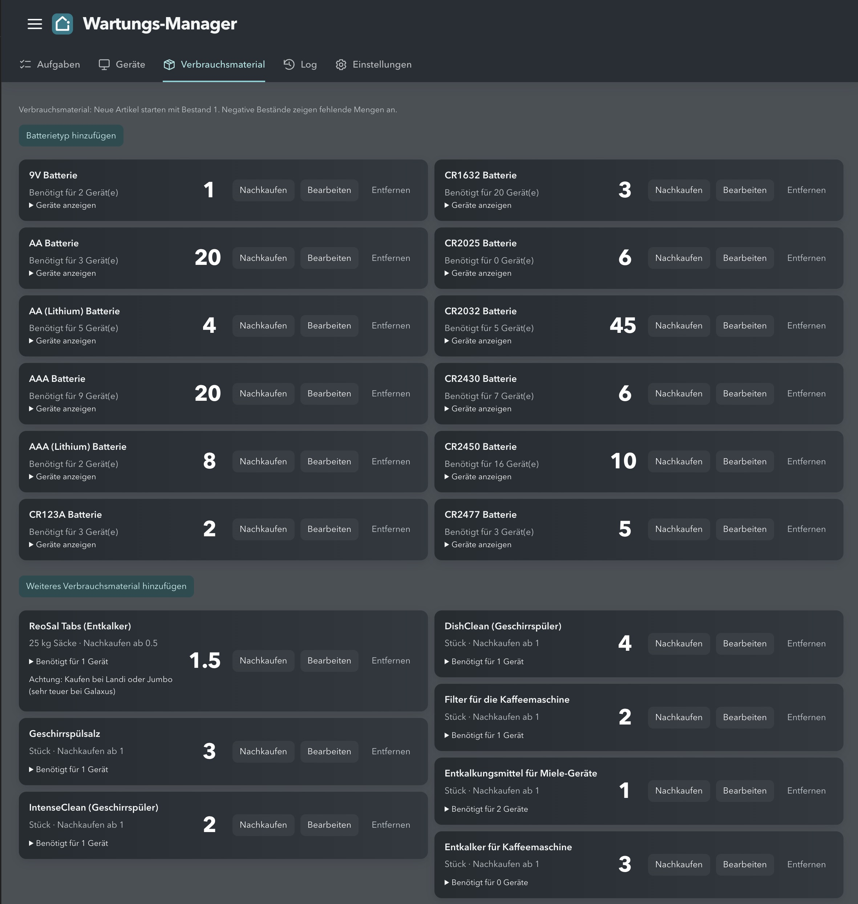
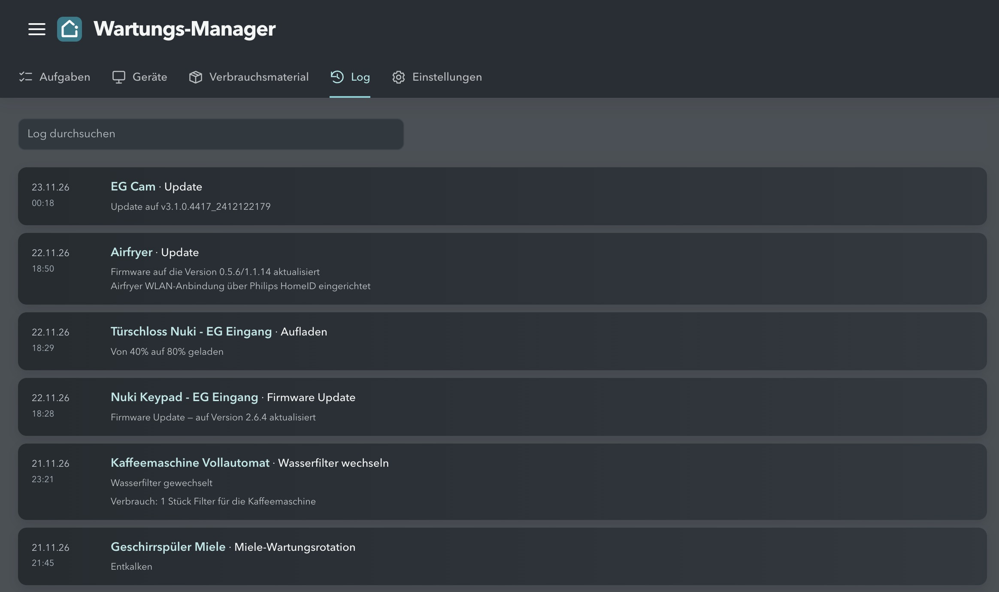
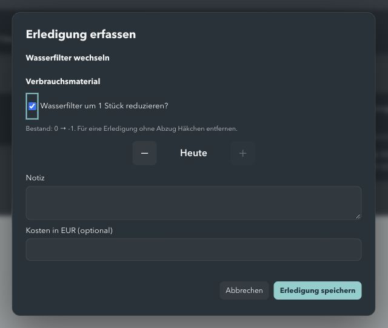
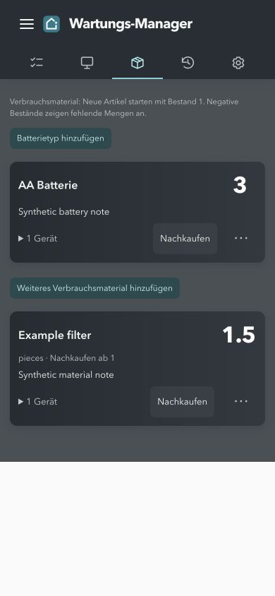

# Wartungs-Manager

Wartungsplanung und Geräteakten und Verbrauchsmaterialverwaltung für Home Assistant – automatisierte, zeit- oder sensorabhängige Aufgaben und ein Wartungslog.

Einmal Regeln und Zuordnungen festlegen: Der Wartungs-Manager berechnet Fälligkeiten, zeigt Batteriewarnungen an und erstellt Nachkaufaufträge bei niedrigen Beständen. Bestätigte Erledigungen schreiben die Historie und die nächste Wartung fort; verknüpftes Verbrauchsmaterial wird nach deiner Bestätigung vom Bestand abgezogen.

[English documentation](README.en.md) · [Problem melden](https://github.com/Raffaelloo22/homeassistant-wartungs-manager/issues)

## Was automatisch passiert

| Ablauf | Auslöser | Ergebnis |
| --- | --- | --- |
| **Wartungstermine berechnen** | Eine gespeicherte Regel und das aktuelle Datum | Fällige, überfällige und kommende Aufgaben werden einsortiert. Nach einer Erledigung werden Intervall, Saisonzyklus oder nächster Rotationsschritt berücksichtigt. |
| **Sensorabhängig erinnern** | Ein zugeordneter numerischer Sensor meldet einen Wert unter der eingestellten Schwelle | Die Wartungsaufgabe wird fällig. Unbekannte oder ungültige Werte werden als ausstehend behandelt. |
| **Batteriewechsel anzeigen** | Ein gültiger Batteriestand unterschreitet den gemeinsamen Home-Assistant-Schwellenwert | In der geöffneten Aufgabenansicht erscheint eine Batterieaufgabe mit Anzahl und Typ, sofern diese erfasst sind. Batteriestand und Warnschwelle sind nachvollziehbar sichtbar. |
| **Materialverbrauch buchen** | Du erledigst eine verknüpfte Aufgabe und bestätigst den Bestandsabzug | Die vorgesehene Menge wird abgezogen und mit Material und Menge in der Historie dokumentiert. Der Dialog zeigt vorab den Bestand vorher und nachher. Bei Batterien stammt die Menge aus der Geräteakte. |
| **Nachkaufaufträge erstellen** | Nach einer Bestandsänderung liegt ein Artikel auf oder unter seiner individuellen Nachkaufgrenze | Unter **Aufgaben → Nachkaufen** erscheint der passende Artikel. Nach einem eingetragenen Einkauf steigt sein Bestand; reicht er wieder über die Grenze, ist der automatische Nachkauf erledigt. |
| **Geräteinformationen übernehmen** | Du bestätigst eine Sammelerfassung ausgewählter HA-Gerätetypen | Bezeichnung, Hersteller, Modell und HA-Verknüpfung werden übernommen; der Gerätetyp bestimmt eine passende Kategorie. Bestehende Zuordnungen und mögliche Dubletten werden erkannt. Bereiche folgen der HA-Gerätezuordnung. |
| **Kaufdatum ergänzen** | Ein Kauf- oder Bestellereignis mit genauem Datum wird in der Historie erfasst | Ein noch leeres Kaufdatum der Geräteakte wird ergänzt. Ein vorhandenes Kaufdatum bleibt erhalten. |
| **Wochenmeldung zusammenstellen** | Der eingestellte Wochentag und die Uhrzeit sind erreicht | Eine optionale Home-Assistant-Mitteilung fasst offene Wartungen und Nachkäufe zusammen. Dafür muss das Dashboard nicht geöffnet sein. |

Die tatsächliche Erledigung, verbrauchte Mengen und Einkäufe werden von dir bestätigt. Ein Nachkaufauftrag ist eine Einkaufserinnerung; er bestellt keine Ware. Prozentbasierte Batteriewarnungen werden im geöffneten Dashboard berechnet. Gespeicherte Wartungsregeln und Bestandsbuchungen verarbeitet die Integration in Home Assistant.

## Screenshots

Die ersten vier Screenshots zeigen eine eingerichtete Installation. Die zusätzlich als Demobilder gekennzeichneten Aufnahmen stammen aus einer separaten Testinstanz mit erfundenen Daten. Eine neue Installation startet ohne Geräte oder Beispielaufgaben.

**Aufgaben:** Fällige Arbeiten, Batterieanzahl und -typ sowie Nachkaufbedarf in einer Ansicht.

Geräteakte der Kaffeemaschine mit Aufgaben und Historie

Verbrauchsmaterial mit Batterien, eigenen Artikeln, Beständen und Nachkaufgrenzen

Log mit erledigten Aufgaben, Datum, Erfassungszeit und Verbrauch

Das Log bündelt die Wartungs- und Serviceereignisse mit Gerätelinks und Textsuche. Bei gebuchtem Materialverbrauch werden Artikel und Menge angezeigt.

Erledigung mit Bestandsvorschau – Beispiel mit Demodaten

Vor dem Speichern sind Datum, Materialmenge und resultierender Bestand sichtbar. Der Abzug kann abgewählt werden. Ein negativer Bestand kennzeichnet eine fehlende Menge.

Verbrauchsmaterial auf dem Smartphone – Beispiel mit Demodaten

## Funktionen im Detail

### Geräte und Home Assistant

- Manuelle Geräteakten und direkt mit Home Assistant verknüpfte Geräte gemeinsam verwalten: Hersteller, Modell, Kaufdatum, Seriennummer, Batterieangaben und Notizen. Kosten lassen sich bei Historienereignissen erfassen.
- HA-Geräte gesammelt übernehmen: nach Gerätetyp und Text suchen, pro Typ bereits erfasste Geräte, neue Kandidaten und Konflikte sehen und die Auswahl vor der Übernahme prüfen. Die Sammelerfassung ist wiederholbar und berücksichtigt auch Lager, Archiv und Papierkorb beim Duplikatschutz.
- Geräte miteinander verknüpfen und die Verknüpfung von beiden Seiten bearbeiten; Gerät und zugehörige Komponenten über anklickbare Tags öffnen.
- Nach Kategorie, HA-Bereich und Text filtern. Die Suche findet Namen auch ohne Akzente oder Umlaute.
- Zwischen **Aktiv**, **Lager**, **Archiv** und **Papierkorb** wechseln. Lager und Archiv behalten ihre Akten und Historie, ohne Aufgaben in der aktiven Liste anzuzeigen. Geräte aus dem Papierkorb lassen sich wiederherstellen oder endgültig entfernen.
- Auf Gerätekacheln Aufgabenanzahl, zugehöriges Verbrauchsmaterial sowie Batteriestand und Warnschwelle sehen.

### Wartung nach Datum, Zyklus oder Sensor

| Fälligkeitsregel | Verwendung |
| --- | --- |
| **Termin** | Einmalige Aufgabe an einem Datum. Nach der Erledigung bleibt der Eintrag in der Historie und verschwindet aus den offenen Aufgaben. |
| **Intervall / Einplanen** | Wiederholung in Monaten und zusätzlichen Tagen ab der tatsächlichen letzten Erledigung. Ein erster Termin oder Planmonat ist möglich; ein noch unbekanntes Intervall bleibt zum Einplanen offen. |
| **Saison** | Jährlich zu einem Kalenderdatum, optional auf einen bestimmten Wochentag in dessen Nähe gelegt. Unerledigte Jahreszyklen bleiben sichtbar. |
| **Rotation** | Mehrere Arbeitsschritte abwechselnd in einem festen Monatsabstand ausführen. Nach der Erledigung folgt der nächste Schritt; nach dem letzten beginnt die Folge von vorne. |
| **Messwert** | Fällig, sobald ein numerischer HA-Sensor die eingestellte Schwelle unterschreitet. Das Formular zeigt den aktuellen Sensorwert und die Einheit. |
| **Nach Geräteanzeige** | Bei Bedarf gemäss Anzeige am Gerät erledigen. Aus mehreren Erledigungen wird ein unverbindlicher typischer Abstand ermittelt. |
| **Ohne Fälligkeit** | Eine Arbeit ohne festen Termin vorhalten und bei Bedarf dokumentieren. |

- Aufgaben sind nach **Jetzt erledigen**, **Termin vereinbart**, **Bald fällig**, **Geplant**, **Nach Geräteanzeige** und **Nachkaufen** geordnet, soweit sie zur aktuellen Auswahl passen.
- **Jetzt** ist die Standardauswahl. **Bald** umfasst morgen bis einschliesslich in 14 Tagen, **Alle** zeigt alle offenen Aufgaben. Die Suche berücksichtigt Gerät und Aufgabentext.
- Ein gebuchter Ausführungstermin lässt sich zusätzlich zur eigentlichen Fälligkeit erfassen.
- Sensor und Verbrauchsmaterial über Suchfelder auswählen; bei Rotationen kann jeder Arbeitsschritt ein anderes Material verwenden.
- Wiederkehrende, aktuell erledigte Aufgaben bleiben in der Geräteakte mit ihrem nächsten Termin zugänglich.

### Verbrauchsmaterial und Nachkaufen

- Mit der sofortigen Textsuche Batterien und weitere Materialien nach Bezeichnung, Notizen, Einheit, Shop-Adresse oder zugeordnetem Gerät finden. Akzente und Umlaute werden wie in den anderen Suchfeldern berücksichtigt; **×** leert die Suche.
- Zwischen **Kacheln** und einer kompakten **Lagerliste** mit Menge, Bezeichnung und zugeordneten Geräten wechseln. Aktionen bleiben in der Kachelansicht verfügbar; „Entfernen“ steht im jeweiligen Bearbeitungsfenster. Die Suche gilt für beide Darstellungen.
- Pro Batterietyp oder Material einen optionalen **Shop-Link** hinterlegen. **Shop** öffnet die hinterlegte Adresse in einem neuen Tab – direkt beim Artikel oder beim zugehörigen Nachkaufauftrag.
- Batterietypen, Filter, Salz, Reinigungs- und Entkalkungsmittel oder andere eigene Artikel verwalten – jeweils mit Bestand, Nachkaufgrenze, Notizen und Gerätezuordnung.
- Bei Batterien Typ und Anzahl pro Gerät getrennt erfassen. Geräte erscheinen anhand ihres Batterietyps automatisch in der Verwendungsliste; zusätzliche manuelle Zuordnungen sind möglich. **Geräte anzeigen** nennt die benötigte Batterieanzahl je Gerät. Fest verbaute Akkus werden nicht als Wechselbatterievorrat geführt.
- Neue Batterietypen starten mit Bestand 1. Weitere Materialien unterstützen eigene Einheiten, Dezimalmengen und einen zunächst unbekannten Bestand; negative Bestände zeigen fehlende Mengen an.
- Bestand direkt über die grosse Zahl bearbeiten. **Nachkaufen** erfasst auch unabhängig von der Grenze einen manuellen Nachkaufauftrag mit gewünschter Menge.
- Aufgaben mit Material verknüpfen. Die Erledigung zeigt die Verbrauchsmenge und den resultierenden Bestand vor dem bestätigten Abzug. Eine Geräte-Material-Verknüpfung dient der Zuordnung; für den Verbrauch wird das Material zusätzlich mit der Aufgabe verknüpft.
- **Eingekauft** fragt die tatsächlich gekaufte Menge ab und addiert sie zum Bestand. Automatische Nachkäufe bleiben bei weiterhin zu niedrigem Bestand offen. Artikelnotizen sind auch beim Nachkauf sichtbar und bearbeitbar.

### Historie, Korrekturen und Rückgängig

- Eine Erledigung erzeugt einen Historieneintrag mit dem ursprünglichen Aufgabentext und dem gewählten Datum. Datum per **Heute**, Tageswechsel oder Kalender wählen; Kosten und Notizen ergänzen.
- Wartung, Reparatur, Prüfung, Kauf und eigene Ereignisarten nachtragen. In der Geräteakte steht die vollständige Historie. **Log** bündelt die Wartungs- und weiteren Serviceereignisse mit Datum, Erfassungszeit, Textsuche und Gerätelink; Kauf- und reine Notizeinträge stehen in der Geräteakte.
- Historieneinträge bearbeiten oder entfernen. Verknüpfte Wartungsdaten werden nachgeführt; beim Entfernen eines gebuchten Verbrauchs wird die protokollierte Menge dem aktuellen Bestand wieder gutgeschrieben.
- Eine gerade gespeicherte Erledigung für 30 Sekunden mit **Rückgängig** zurücknehmen. Dabei werden auch zugehöriger Materialverbrauch und Aufgabenzustand zurückgesetzt. Zwischenzeitliche Änderungen werden geschützt.

### Einstellungen und Datenqualität

- Kategorien und Ereignisarten hinzufügen, umbenennen, entfernen und per Drag-and-drop sortieren; die jeweilige Anzahl zugehöriger Einträge sehen.
- Batterieschwelle per Schieberegler direkt mit einem Home-Assistant-Helfer synchronisieren. Den Standardhelfer prüft und erstellt das geöffnete Dashboard bei Bedarf selbst; alternativ kann ein vorhandener Helfer gewählt werden.
- Währung sowie Tag und Uhrzeit der Wochenmeldung einstellen; eine Testmeldung auslösen.
- **Datenprüfung** aufrufen: fehlende HA-Geräte und Sensoren, unvollständige Batterieangaben, ungültige Materialzuordnungen, verwaiste Verknüpfungen und mögliche Dubletten mit Links zu den betroffenen Akten prüfen. Die Prüfung verändert keine Daten.
- Verzeichnis inklusive Einstellungen als JSON exportieren und nach ausdrücklicher Bestätigung wiederherstellen. **Daten zurücksetzen** entfernt Gerätedaten, Aufgaben und Vorräte; Kategorien, Ereignisarten und allgemeine Einstellungen bleiben erhalten.

Auf Desktop und Smartphone bleiben dieselben Funktionen verfügbar. Auf dem Smartphone verwenden die Reiter Symbole und Verbrauchsmaterial-Kacheln eine kompakte Aktionszeile. Die geöffnete Oberfläche aktualisiert Daten regelmässig und übernimmt Batteriewerte aus Home Assistant; offene Formulare werden dabei geschützt.

## Voraussetzungen

- Home Assistant **2026.11.0 oder neuer**.
- Ein Administratorenkonto in Home Assistant. Oberfläche und Schnittstelle sind nur für Administratoren zugänglich.
- Keine Cloud-Anmeldung und kein Abonnement. Auch Geräte ohne Home-Assistant-Zuordnung können erfasst werden.

Die Einrichtung ist auf Deutsch und Englisch verfügbar. Die Oberfläche dieser ersten öffentlichen Version ist deutsch. Datumsformat: `dd.mm.yy`; Dezimalzeichen: Punkt. Die Währung für Kosten ist einstellbar. Vorhandene Installationen behalten CHF; eine neue Einrichtung verwendet die Home-Assistant-Währung, sofern vorhanden.

## Installation

### Marketplace oder HACS

[Repository in Home Assistant öffnen](https://my.home-assistant.io/redirect/hacs_repository/?owner=Raffaelloo22&repository=homeassistant-wartungs-manager&category=integration).

Solange das Repository noch nicht im gemeinsamen Katalog gelistet ist, `https://github.com/Raffaelloo22/homeassistant-wartungs-manager` als benutzerdefiniertes Repository mit Typ **Integration** hinzufügen. Einen Release herunterladen und einem angezeigten Neustart-Hinweis folgen.

Anschliessend unter **Einstellungen → Geräte & Dienste → Integration hinzufügen** nach **Wartungs-Manager** suchen. Nach der Einrichtung steht **Wartung** in der Seitenleiste zur Verfügung.

[Einrichtung direkt starten](https://my.home-assistant.io/redirect/config_flow_start/?domain=ha_wartung).

Der Marketplace ist seit Home Assistant 2026.11 eingebaut und nutzt denselben Katalog wie HACS. Die Aufnahme in diesen Katalog wird gesondert geprüft; ein funktionierender Installationslink bedeutet noch keine Katalogaufnahme.

### Manuell

1. Einen Release herunterladen.
2. Den Ordner `custom_components/ha_wartung` in das Home-Assistant-Konfigurationsverzeichnis unter `custom_components` kopieren. Den Namen `ha_wartung` beibehalten.
3. Home Assistant neu starten.
4. Die Integration unter **Einstellungen → Geräte & Dienste** hinzufügen.

Pro Home-Assistant-Instanz gibt es ein Wartungsverzeichnis. Es startet leer; der Release enthält keine Haushaltsdaten, importierten Geräte oder Beispielaufgaben.

## Erste Schritte

1. Unter **Geräte** ein neues Gerät anlegen oder **Sammelerfassung von Home Assistant Geräten** wählen. Gerätetypen und Vorschau vor der Übernahme prüfen.
2. Kategorie festlegen und bei Wechselbatterien Typ und Anzahl eintragen. Der Bereich stammt aus der Home-Assistant-Gerätezuordnung.
3. In der Geräteakte **Neue Aufgabe** wählen. Neue Aufgaben starten mit **Termin**. Wiederkehrende Arbeiten über Intervall, Saison oder Rotation planen.
4. Unter **Verbrauchsmaterial** Bestände erfassen und Material mit Aufgaben und Geräten verknüpfen.
5. Unter **Aufgaben** Erledigungen erfassen. Der Dialog fragt einen Bestandsabzug ab. Für 30 Sekunden steht **Rückgängig** bereit; Historieneinträge lassen sich auch danach bearbeiten.

**Jetzt** enthält fällige oder zu klärende Aufgaben. **Bald** umfasst morgen bis einschliesslich in 14 Tagen. **Alle** zeigt alle offenen Aufgaben. Erledigte einmalige Aufgaben stehen in der Historie. Wiederkehrende Aufgaben stehen bis zur nächsten Fälligkeit unter **Erledigte Aufgaben** in der Geräteakte.

## Batteriewarnung und Messwertaufgaben

Die Batteriewarnung verwendet standardmässig `input_number.batterien_schwellwert`. Beim Öffnen prüft die App diesen Standardhelfer und legt ihn bei Bedarf mit 20% an. Vorhandene Werte bleiben erhalten. In den allgemeinen Einstellungen kann stattdessen ein vorhandener `input_number`-Helfer gewählt werden. Der Schieberegler unter **Einstellungen → Batteriewarnung** schreibt direkt in den ausgewählten Helfer. Die Währung für Kosten lässt sich ebenfalls in den allgemeinen Einstellungen festlegen.

Eine Warnung erscheint bei gültigem Batteriestand strikt unter der Schwelle. Unbekannte und ungültige Werte lösen keine Prozentwarnung aus. Bei nicht verfügbarem Helfer gilt ein gekennzeichneter Ersatzwert von 20%. Lager-, Archiv- und Papierkorb-Geräte sowie Geräte mit deaktivierter Batteriewarnung sind ausgeschlossen.

Prozentwarnungen werden in der Oberfläche berechnet. Sie sind keine separat gespeicherten Wartungsregeln und derzeit **nicht Teil der Wochenmeldung**. Ein erfasster Batteriewechsel verändert den vom Gerät gemeldeten Prozentwert nicht.

Für **Messwert** genügen Sensor und Schwelle. Das Formular zeigt den aktuellen Wert samt Einheit. Unbekannte, nicht verfügbare, wiederhergestellte oder nicht numerische Werte bleiben ausstehend. Nach einer Erledigung wird eine neuere HA-Meldung abgewartet. Diese bestätigt keinen neuen physischen Messvorgang.

## Daten, Sicherung und Updates

Die Daten liegen lokal im Home-Assistant-Integrationsspeicher ausserhalb des Code-Verzeichnisses. Eine vollständige Home-Assistant-Sicherung mit Konfigurationsverzeichnis enthält sie. Es gibt keine Telemetrie oder automatische Übermittlung der Wartungsdaten.

Unter **Einstellungen → Daten exportieren und importieren** kann das Verzeichnis zusätzlich als JSON gespeichert werden. Exporte enthalten unter Umständen Namen, Seriennummern, Notizen und Kaufdaten. Sie sind privat zu behandeln. Ein Import ersetzt nach Bestätigung das vorhandene Verzeichnis; er führt es nicht zusammen.

Updates über Marketplace oder HACS installieren und anschliessend einem Neustart-Hinweis folgen. Vor dem Update eine aktuelle HA-Sicherung erstellen. Die Domäne und der Speichername bleiben `ha_wartung`; vorhandene Verzeichnisse bleiben beim Austausch einer älteren Installation derselben Integration erhalten. Zwei Repositories mit dieser Domäne dürfen nicht gleichzeitig installiert werden.

**Daten zurücksetzen** entfernt Geräte, Aufgaben, Historie, Nachkäufe und Verbrauchsmaterial endgültig. Kategorien, Ereignisarten mit Reihenfolge sowie allgemeine Einstellungen bleiben erhalten. Home-Assistant-Geräte, Helfer, Entitäten und Automationen werden nicht entfernt.

## Entfernen und erneute Einrichtung

Die Integration unter **Einstellungen → Geräte & Dienste** entfernen, danach ihren Code über Marketplace oder HACS entfernen und gegebenenfalls neu starten. Der Seitenleisteneintrag verschwindet. Wartungsdaten und Batterieschwellenwert-Helfer bleiben erhalten. Bei erneuter Einrichtung kann das gespeicherte Verzeichnis wieder geladen werden.

Wer die Wartungsdaten entfernen möchte, exportiert vorher benötigte Angaben und führt **Daten zurücksetzen** vor dem Entfernen der Integration aus. Dieser Vorgang behält allgemeine Einstellungen, Kategorien und Ereignisarten. Einen nicht mehr benötigten Helfer separat in Home Assistant entfernen und vorher prüfen, ob ihn andere Automationen oder Dashboards nutzen. `.storage`-Dateien nicht von Hand bearbeiten.

## Fehlerbehebung und Einschränkungen

- **Seitenleiste fehlt:** Als Administrator anmelden, Einrichtung prüfen und Seite neu laden. Nach Updates einem Neustart-Hinweis folgen.
- **Messwert ausstehend:** Der Sensor muss existieren und eine Zahl liefern. Ein Textwert wie `not_charging` ist kein Batterie-Prozentwert.
- **Batteriewarnung bleibt:** Entscheidend ist die gemeldete Prozentzahl. Nach einem Wechsel muss der Sensor einen neuen Wert melden.
- **Duplikate bei der Sammelerfassung:** Die Vorschau prüfen. Vorhandene HA-Zuordnungen und Namenskonflikte werden übersprungen; anders benannte manuelle Akten selbst beurteilen.
- **Bestand unerwartet:** Materialzuordnung und Verbrauchsmenge der Aufgabe prüfen. Negative Bestände zeigen bei weiterem Verbrauchsmaterial fehlende Mengen an.
- **Wochenmeldung:** Sie erscheint als persistente Mitteilung in Home Assistant und wird nicht per E-Mail oder mobilem Push versendet. Ihre Vorschau umfasst sieben Tage; der Filter **Bald** auf dem Dashboard umfasst 14 Tage.

Fehler und Wünsche über [Issues](https://github.com/Raffaelloo22/homeassistant-wartungs-manager/issues) melden. Versionen, reproduzierbare Schritte und anonymisierte Screenshots oder Logs angeben. Keine Exporte, Zugriffstoken oder privaten Haushaltsangaben veröffentlichen. Sicherheitshinweise stehen in [SECURITY.md](SECURITY.md), Entwicklungsinformationen in [CONTRIBUTING.md](CONTRIBUTING.md).

## Unterstützen

Wenn dir der Wartungs-Manager hilft, kannst du die Weiterentwicklung mit einem Kaffee unterstützen:

## Lizenz

[MIT](LICENSE). Copyright © 2026 Raffaelloo22.
